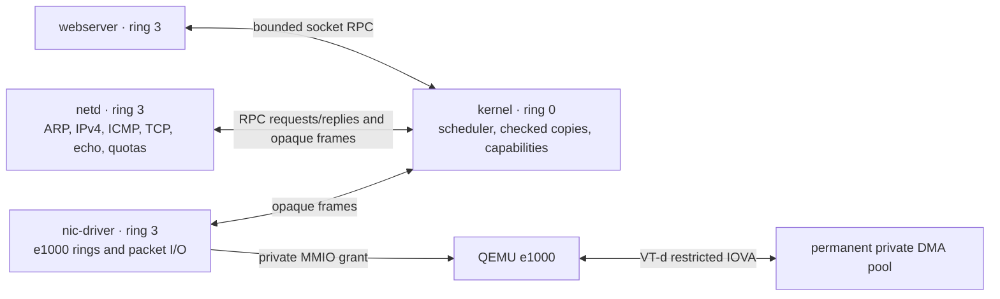

# Rust kernel

A small x86-64 kernel written in stable Rust, with a QEMU development target
and an experimental Intel/UEFI hardware port.
The normal build runs **three separate ring-3 services per NIC**: an HTTP server,
an allocation-free [smoltcp](https://docs.rs/smoltcp/0.14.0/smoltcp/) network
service, and an Intel e1000 driver. The kernel provides address spaces,
preemption, checked IPC, and a narrow VT-d device-assignment boundary.
Ethernet packet handling, TCP/IP, and HTTP run outside ring 0.
An optional, separate userspace target ports a limited subset of real Rust `std`
using a repository-local pinned nightly; the normal kernel and services remain
stable Rust `no_std` builds.

The default target is **q35, one CPU, an e1000 on PCI root bus 0, and QEMU's
Intel IOMMU**. The separate [hardware port](docs/HARDWARE.md) adds UEFI/GRUB
boot, firmware discovery, an APIC timer, and strict VT-d interrupt remapping.
**Public production use is not approved**; see [security status](SECURITY.md).
No physical machine has been qualified.

## Quick start

Install Rust with [rustup](https://rustup.rs/), QEMU, GNU binutils, Make, and
Python 3.10+. On Debian/Ubuntu:

```sh
sudo apt-get update
sudo apt-get install make binutils qemu-system-x86 python3
make setup
make run
```

The first build downloads the Rust bare-metal target and locked dependencies;
later builds use Cargo's cache. `make run` builds the kernel and all three service
ELFs, then boots QEMU with serial output in your terminal. Press **Ctrl-a**,
release both keys, then press **x** to exit. `make run-gui` also opens a VGA
window; a graphical desktop and QEMU display backend are required.

The default development launch uses these required platform options:

```text
-machine q35 -device intel-iommu,intremap=off -cpu max,-apic -smp 1 -accel tcg
```

KVM access, TAP setup, root privileges, GRUB, and an ISO builder are unnecessary.
The kernel refuses device assignment if the required IOMMU or CPU/platform
conditions are missing. There is no fallback to unrestricted DMA. Keep `-apic`
in the CPU model: this QEMU-specific configuration has no local APIC device and
uses PIC/PIT scheduling interrupts instead. The reason is explained below.

Startup messages identify the services and endpoints; their order can vary:

```text
Isolation: three address spaces per NIC; private IPC and VT-d DMA domains
Userspace network service: CPL=3
e1000 driver: CPL=3, VT-d DMA grant active
IPv4: 10.0.2.15/24, gateway 10.0.2.2
TCP echo listening on 10.0.2.15:1234
Userspace web server: CPL=3
HTTP listening on 10.0.2.15:80
```

## Web server

Open **http://127.0.0.1:8080/** after starting `make run`. QEMU forwards the
localhost port to guest TCP port 80. The first connection can take several
seconds while QEMU resolves the guest's network address.

```sh
curl http://127.0.0.1:8080/
curl http://127.0.0.1:8080/healthz
curl -I http://127.0.0.1:8080/
```

The HTTP parser and embedded page live in `build/webserver.elf`. `/healthz`
returns `ok` followed by a newline. Both routes support GET and HEAD; query
strings do not change route selection. Unknown paths return 404, unsupported
methods return 405, malformed requests return 400, and headers exceeding 2048
bytes return 431.

The server accepts HTTP/1.0 and HTTP/1.1, sends Content-Length, and closes each
connection after one response. HTTP/1.1 requires one nonempty Host header.
There are four connection slots with fixed buffers. Partial requests have an
absolute 5-second deadline; stalled sends or closes time out after 10 seconds.
The network service applies additional admission and lifetime limits below.
Request bodies, chunked transfer, persistent connections, and TLS are unsupported.

Use `make run HTTP_PORT=8081` to choose another host HTTP port. TCP echo is
available separately on localhost port 5555 during normal operation; service
restarts can reset existing connections.

## Services and IPC

Each service instance has its own CR3, physical backing, ELF image, stack, heap, and
saved extended CPU state. Each NIC receives a separate group of driver, network,
and web services. Their common virtual entry address does not imply shared
memory. The following diagram shows one group; IPC never crosses groups.



| Executable | Responsibility | Access |
| --- | --- | --- |
| `build/webserver.elf` | HTTP parsing and responses | Four socket handles, port 80 only |
| `build/netd.elf` | smoltcp, TCP echo, HTTP sockets, admission control | Frame queues and socket RPC endpoint |
| `build/nic-driver.elf` | e1000 register programming and RX/TX descriptors | Its assigned MMIO window, private DMA pool, and frame queues |

The kernel never interprets Ethernet, IP, TCP, or HTTP packets in the normal
build. For each NIC it copies opaque frames through **two fixed queues**, one per direction,
each holding **16 frames of at most 1514 bytes**. Full queues return `EAGAIN`.
No service receives another service's pointers or direct access to its buffers.

Socket RPC uses fixed `Request` and `Reply` records containing integers and at
most 4096 payload bytes. One web request per NIC can be outstanding. The kernel checks
full user buffer ranges and read/write permissions before copying data or
changing queue state. It issues monotonically increasing request-generation
IDs, validates reply IDs and lengths, and rejects stale replies. An unanswered
RPC has a **2-second deadline**, after which the affected services restart.

The shared `abi.rs` uses RAX for the syscall number/result and RDI, RSI, RDX for
arguments. A DPL-3 `int 0x80` gate enters a TSS kernel stack. Errors are negative
error numbers. Capabilities are assigned from the calling process's identity;
passing another handle or syscall number cannot select another service's role.

| Number | Call | Allowed caller / behavior |
| --- | --- | --- |
| 0 | Poll | All services; yield to the scheduler and update heartbeat |
| 1 | Clock | All services; HPET milliseconds |
| 2 | Socket state | Web; state, readiness flags, and queued TX bytes via RPC |
| 3 / 4 | Receive / send | Web; handle, user buffer, length; at most 4096 bytes |
| 5 / 6 | Close / abort | Web; socket handle |
| 7 | Listen | Web; handle and port 80 only |
| 8 | Log | All services; UTF-8, at most 512 bytes per call and 4096 bytes/s per service |
| 9 | Exit | All services; stop the caller and trigger supervised recovery |
| 10 / 11 | Frame receive / send | Network service; copy from RX / into TX queue |
| 12 / 13 | Network request / reply | Network service; receive socket RPC / submit its reply |
| 14 / 15 | Driver RX / TX | NIC driver; copy into RX queue / from TX queue |
| 16 | Driver ready | NIC driver; request kernel-controlled bus-master enable |
| 17 | MAC | Network service; read the driver-registered packed MAC |
| 18 | Register MAC | NIC driver; publish a validated unicast MAC |
| 19 | Random | Network service; fill exactly eight writable private bytes; hardware failure is an error |
| 20 | Network configuration | Network service; copy the current validated configuration |
| 21 | Random bytes | All services; at most 256 writable private bytes; entropy failure leaves the destination unchanged |
| 22 | Standard output/error | All services; descriptor 1 or 2, at most 512 input bytes; partial writes or `EAGAIN`, sharing the log budget |

## Userspace heap

Every webserver, network service, and driver initializes a private **512 KiB**
heap at startup, including after a service restart. `userspace/heap.rs` provides
Rust's global allocator, so `extern crate alloc` enables `Box`, `Vec`, `String`,
and other `alloc` collections in these `no_std` programs. The webserver's four
connection objects now live on this heap; their buffer sizes and connection
limits remain bounded.

The allocator uses aligned first-fit allocation with a 16-byte minimum block,
returns freed blocks to an address-ordered free list, and merges adjacent free
blocks. It supports zeroed allocation and reallocation; failed reallocation
preserves the old block. Use fallible reservation for requests that may exceed
the budget:

```rust
extern crate alloc;
use alloc::vec::Vec;

let mut buffer = Vec::<u8>::new();
buffer.try_reserve_exact(4096)?;
buffer.resize(4096, 0);
```

`try_reserve` / `try_reserve_exact` report exhaustion. Infallible allocations
such as `Box::new` and `Vec::with_capacity` terminate the process through its
panic/exit handler on exhaustion. The service supervisor's existing restart
limits still apply. Allocator operations do not log, allocate recursively, or
make syscalls. Each allocator has its own lock and metadata in private process
memory; timer preemption can switch to another process with a separate heap.

The fixed heap occupies `0x40100000..0x40180000` (end exclusive), is writable
and non-executable, and has a 4 KiB unmapped guard on each side. ELF segments
must end by `0x400ff000`. The existing process backing supplies these pages, so
this change does not enlarge the kernel's reserved physical memory. A restart
zeros the entire heap and resets allocator metadata. Freed memory within a live
process is not scrubbed unless zeroed allocation is requested. Guard pages
protect the arena boundary; they do not detect overflows between allocations.

There is no heap growth, `mmap`/`brk`, or kernel allocator. The optional `std`
port below uses the same fixed userspace allocator.
Fragmentation and alignment can cause allocation failure before all 512 KiB is
used. The heap supplies one prerequisite for larger Rust services; Actix/Axum
still require additional OS and runtime support. Run `make test-host` for
allocator regressions, `make test-userspace` for real ring-3 allocation/OOM and
permission probes, and `make test-services test-multi-nic-isolation` for private
heap isolation and restart checks with the normal service architecture.

## Userspace Rust standard library

The optional `x86_64-unknown-kernel` target builds upstream Rust `std` with a
small platform backend and a process startup runtime. It supports `Box`, `Vec`,
`String`, `HashMap`, formatting, stdout/stderr, monotonic `Instant`, yielding
sleep, thread-local state, `Mutex`, and `OnceLock`. Each process still has one
user thread and a fixed 512 KiB private heap. HashMap seeding requires hardware
entropy; failure aborts the caller instead of using predictable fallback keys.

```sh
make setup-std    # Install the private compiler and prepare patched std sources.
make std-demo     # Build an ordinary Rust fn main() using the real std library.
make std-kernel   # Embed the demo in a separate kernel regression image.
make test-std     # Boot that image in QEMU and check the runtime and failure paths.
make check-std    # Run the std-specific build, formatting, and lint checks.
```

The first std build downloads `nightly-2026-04-15` and its Rust sources into
`target/std-toolchain/`; these targets currently require an x86-64 Linux build
host. This does not change the default rustup toolchain or patch
a shared installation. The port checks upstream source hashes before applying
its overlays. Normal `make run` continues to build the existing three services
with stable Rust; it does not replace the HTTP server with the std demo.

| Artifact | Purpose |
| --- | --- |
| `build/std/std-demo.elf` | Ring-3 executable linked with the ported standard library |
| `build/std/toolchain.json` | Pinned compiler identity, port fingerprint, and ELF hash |
| `build/std-test/kernel.bin` | Bootable regression image embedding the demo |

The demo source is `userspace/std-demo/src/main.rs`. The `std-test` image uses
the separate legacy userspace test harness, not the normal service/VT-d test.
It exercises ordinary Rust containers and runtime facilities, syscall buffer
boundaries, process exits, panic/OOM containment, and reset of private state.

Standard output is terminal output through COM1: writes are bounded, can be
partial, and return `WouldBlock` under queue or rate pressure. Newlines receive
terminal conversion and long fragments may receive visible framing. This is not
a transparent binary stream. Applications should handle backpressure and yield;
`println!` panics if output fails. Serial command input remains owned by the
kernel console, so nonempty stdin reads return `Unsupported`.

`std::net`, filesystem access, child-process spawning, and user-thread creation
remain unsupported. `SystemTime::now` panics because no wall clock is exposed;
arguments/environment are empty and TLS destructors do not run at process exit.
There is no Tokio runtime or Axum/Actix integration. Those need socket APIs,
readiness/deadline waiting, and further runtime work. See the
[std port contract and limitations](userspace/std-port/README.md).

## CPU, memory, and scheduling

Each ELF occupies a private 2 MiB virtual window beginning at `0x40000000`,
with a 64 KiB stack and a 512 KiB heap. Code is RX, constants are R/NX, and
data, stacks, and heaps are RW/NX. The pages immediately below and above
each heap, and below each user stack, are unmapped. Kernel memory, page
tables, trap stacks, and the other processes' physical backing remain
supervisor-only. Only the driver receives the extra MMIO and DMA mappings.

Kernel text is RX, constants are R/NX, and writable kernel storage is RW/NX.
The null page and guards below boot, trap, and double-fault stacks are unmapped.
NX and CR0.WP enforce page permissions; SMEP and SMAP are enabled when available.
The broad supervisor identity mapping remains an explicit limitation.

Process switches save and restore **FXSAVE64 state**: x87/MMX, MXCSR, and
XMM0–XMM15. Restarts clear that state as well as program memory. FXSR, SSE, and
SSE2 support are required. OSXSAVE remains disabled: AVX/XSAVE instructions are
not supported, even if the emulated CPU advertises wider vector capabilities.

The system schedules up to eight groups of three services on **one CPU**,
without user threads or a general process-launching API. A 100 Hz timer (PIT in development,
local APIC in the hardware build) can preempt a process
that never yields. Userspace runs with IF set and IOPL zero. The kernel handles
traps and IPC with IF clear and bounds a service's syscall run to **64 calls or
10 milliseconds**, checked between calls. Kernel operations are not themselves
preempted. Driver and network services must yield at least every **2 seconds**;
a missed heartbeat triggers recovery.

| Failure | Recovery |
| --- | --- |
| Web or network process fault/exit; network RPC timeout | Restart that NIC’s network and web services; clear its pending RPC and frame queues |
| Driver fault/exit, heartbeat expiry, or source-attributed DMA violation | Disable that NIC’s bus mastering, reset/quiesce it, revoke its DMA mappings, then restart its three services |
| Device teardown cannot be completed safely | Quarantine that NIC; do not resume its device access |
| Global IOMMU failure, fault overflow, or unknown fault source | Quarantine all NICs because isolation cannot be established |

Restart delays back off from **100 ms to 6400 ms** for repeated failures.
Connection state on the affected NIC is discarded during dependent-service
restarts, so its clients must reconnect. Other NICs retain their connections. Timer preemption, deadlines, queues, and restart supervision
bound resource use; they do not guarantee service availability against a
malicious process or network peer.

## NIC and DMA boundary

The supported NIC is QEMU's **e1000 / Intel 82540EM** (`8086:100e`) directly on
**PCI root bus 0**. `e1000e`, devices behind bridges, arbitrary requester aliases,
and general PCI passthrough are outside this implementation.

Each driver maps its own 128 KiB MMIO window at `0x50000000` and a permanently
allocated **260 KiB (`0x41000`) DMA pool** at `0x50200000`. VT-d gives each NIC a
separate domain mapping only its pool, starting at **IOVA `0x10000000` plus
`0x200000` per interface index**. Peer pools, unassigned requesters, and other
IOVAs are denied; there is no DMA identity or pass-through domain. Each pool contains
no kernel objects, stays pinned through resets, and is never reused as another
process's memory. The driver uses 64 RX and 64 TX descriptors with fixed buffers.

The kernel owns PCI assignment, VT-d tables, DMA grants/revocation, bus-master
enable/disable, and reset sequencing. Ring-3 code owns normal e1000 operation.
Device teardown stops bus mastering and resets/drains the device before
revoking translations; failure leaves the affected NIC quarantined. Cache
invalidations preserve other NICs’ mappings. ACPI discovery
checks firmware memory ranges, checksums and table lengths. The supported DMAR
shape remains narrow; see the hardware requirements before choosing a machine.

DMA translation alone does **not** isolate QEMU's interrupt-message aperture.
A malicious descriptor can target that aperture to synthesize interrupt messages.
The default development build therefore requires **no local APIC device**, using
`-cpu max,-apic -smp 1`; merely clearing the APIC-enable bit is insufficient.
PCI INTx is disabled, and the guest uses PIC/PIT for scheduling. This is a narrow
QEMU-specific constraint. The separate `baremetal` feature requires a physical
Intel platform with VT-d interrupt remapping, a nonpresent interrupt table, and
compatibility forwarding disabled; it rejects advertised hypervisors. Missing
required isolation or unsupported topology refuses to start the services.

## Networking

`make run` uses QEMU's user-mode backend. The guest has static IPv4 address
**10.0.2.15/24**, gateway **10.0.2.2**, and a **1500-byte IP MTU**. TCP port
**1234** echoes bytes; QEMU forwards it to **127.0.0.1:5555**.

```sh
python3 - <<'PYTHON'
import socket

with socket.create_connection(("127.0.0.1", 5555), timeout=10) as client:
    client.sendall(b"hello from the host\n")
    client.shutdown(socket.SHUT_WR)
    print(client.makefile("rb").read().decode(), end="")
PYTHON
```

Echo handles one client at a time, preserves bytes under backpressure, drains
data after a peer half-close, and reopens after close/reset. Its RX and TX socket
buffers are 16 KiB each. smoltcp supplies retransmission, checksums, sequencing,
and flow control inside the network process.

Use `make run HOST_PORT=5556` to change the host echo port. `QEMU_NET` replaces
the NIC/backend arguments; `make run QEMU_NET="-nic none"` reports the missing
NIC and refuses network startup. Keep the supported platform and NIC constraints
when overriding launch options.

ARP and IPv4 ICMP echo replies are supported. QEMU user-mode networking does
not expose the guest to host `ping 10.0.2.15`; `make test-packets` instead injects
Ethernet frames through a private QEMU socket backend. IPv6, UDP sockets, DHCP,
DNS, VLANs, jumbo frames, and IPv4 fragment reassembly are disabled.

The **network service** applies these limits to new HTTP connections:

| Limit | Value |
| --- | --- |
| Active HTTP connections per source IPv4 address / total | 3 / 4 |
| New SYN allowance per source | Burst 32; refill 16/s |
| New SYN allowance across sources | Burst 64; refill 32/s |
| Source table | 32 entries; expire after 30 idle seconds; no eviction of recent sources |
| Half-open handshake / absolute connection lifetime | 3 seconds / 15 seconds |

Validated SYN retransmissions for an existing tuple spend no additional tokens.
Existing connection traffic and echo do not spend HTTP admission tokens. Invalid
IPv4/TCP checksums are rejected before SYN admission. Existing tuples take
priority over free listeners so retransmission cannot create duplicate sockets.
Clients behind one source address share its quota. These limits do not prevent
distributed abuse, source spoofing, or link saturation. Network startup and
restart use bounded RDSEED/RDRAND access and refuse a missing or exhausted RNG;
no clock-based fallback is used. smoltcp's internal sPCG generator remains
non-cryptographic, so this does not establish secure TCP sequence generation.

## Commands and tests

| Command | Result |
| --- | --- |
| `make` / `make build` | Build `build/kernel.bin` and all three service ELFs |
| `make run` / `make run-gui` | Build and boot with terminal / VGA output |
| `make test` | Run boot, legacy privilege, service isolation, preemption, admission, TCP, ARP/ICMP, and HTTP targets |
| `make test-services` | Exercise the production service/DMA/IPC boundary and recovery |
| `make test-userspace` | Run the separate legacy kernel WP/NX and ring-3 privilege baseline |
| `make test-preemption` | Check TCP progress during busy and syscall-only web loops |
| `make test-host` | Admission, network configuration, and firmware parser regressions |
| `make iso` | GRUB Multiboot2 image for installed firmware platforms |
| `make baremetal-iso` | Experimental Intel hardware image; explicit network settings required |
| `make test-firmware` / `make test-apic` | UEFI handoff / local APIC preemption in QEMU |
| `make test-deployment` | Custom subnet, echo disabled, RNG refusal |
| `make audit` | RustSec checks of all locked dependencies |
| `make test-abuse` | HTTP source quotas, half-open expiry, and recovery |
| `make test-net` | Binary echo, socket/ring wrap, half-close, reconnect, and reset |
| `make test-packets` | Raw Ethernet ARP, ICMP, and checksum rejection |
| `make test-http` | HTTP routes, framing, errors, concurrency, and timeouts |
| `make test-boot` | CPU/memory bootstrap checks without networking |
| `make fuzz` | Local HTTP, TCP, and syscall mutation campaigns |
| `make fuzz-http` / `make fuzz-tcp` | HTTP / raw TCP/IP mutations in a private QEMU network |
| `make fuzz-syscalls` | Seeded ring-3 calls against the production IPC broker |
| `make check` | Formatting and Clippy checks |
| `make setup-std` / `make std-demo` | Prepare the private pinned std toolchain / build the ring-3 demo ELF |
| `make std-kernel` / `make test-std` | Build the separate std regression kernel / boot its QEMU checks |
| `make check-std` | Build and check the optional userspace std port |
| `make debug` | Boot paused; GDB on `127.0.0.1:1234` |
| `make clean` | Remove generated files |

`make test-services` builds the `isolation-test` feature. Its checks cover separate
address spaces and saved SIMD/FPU state, actual forbidden DMA reads and writes,
QEMU interrupt-aperture NMI/INIT/SMI probes, invalid IPC buffers and capabilities,
malformed replies against a real pending RPC, and service crashes/restarts.
The harness probes binary echo during recovery, requires three successful
exchanges after the completion marker, and separately boots without an IOMMU
and with an APIC-present CPU to require refusal before any ring-3 service starts.
These are bounded implementation tests for the stated QEMU target, not a proof
of hardware isolation or VM host security.

The `userspace-test` feature is a deliberately separate baseline using the old
ring-0 e1000/stack path. It checks kernel WP/NX, real CPL, invalid syscalls and
buffers, forbidden memory and I/O access, stack/code permissions, privileged
instructions, direction flags, invalid return stacks, userspace allocation/exhaustion,
heap guard/NX faults, and OOM recovery on `qemu64` and `max`.
Only this feature compiles `src/legacy_net.rs`, `src/e1000.rs`, and the old socket
syscall implementation. It is not the production service/DMA test. The
`fuzz-test` feature uses the new production broker.

TCP/packet and service-isolation harnesses have 30-second deadlines, HTTP has
45 seconds, and the preemption test has 25 seconds. Tests choose temporary
localhost ports and stop their QEMU process on success or failure. Echo includes
a 320 KiB fragmented binary transfer; packet checks include varied ICMP replies
and bad checksums. The boot test has a 15-second limit and requires its success
marker plus QEMU debug-exit status 33. Test images use separate build directories.

Install optional Rust tools when needed:

```sh
rustup component add rustfmt clippy
make check
```

Tools can be overridden, for example `make run QEMU=/path/to/qemu-system-x86_64`.
Append diagnostic options with
`make run QEMU_FLAGS="-d guest_errors -D build/qemu.log"`.

For debugging:

```sh
make debug
# In another terminal:
gdb target/x86_64-unknown-none/release/kernel
(gdb) target remote 127.0.0.1:1234
(gdb) hbreak kernel_main
(gdb) continue
```

Service symbols are in `build/webserver.elf`, `build/netd.elf`, and
`build/nic-driver.elf`, also copied alongside the kernel ELF. Load the symbols
for the service being inspected, for example `add-symbol-file build/netd.elf`.
All services link at `0x40000000`; distinguish their address spaces using CR3
rather than assuming that a virtual address identifies one process. Use a GDB
build with x86-64 support (`gdb-multiarch` on non-x86 hosts).

## Local fuzz campaigns

The fuzz scripts start their own QEMU instance. Network mutations go only to
that child's private Ethernet socket backend; there is no remote-target option.
HTTP cases mutate requests and split them across TCP segments. TCP cases mutate
flags, options, sequence numbers, payloads, checksums, truncation, and fragment
fields, including cases with established connections. Periodic HTTP and binary
echo checks look for service failures after malformed input. The syscall
campaign runs in the web process against the production IPC broker, varying call
numbers, capabilities, handles, pointers, lengths, and socket operations while
checking results and buffer canaries. The `fuzz-test` build uses the three-service
scheduler; it does not enable the legacy ring-0 network stack.

These are seeded, mutation-based robustness tests, not coverage-guided fuzzing.
A successful campaign reports only the cases exercised; it is not a security
proof. `make test` does not run the longer fuzz campaigns.

| Make variable | Default | Applies to |
| --- | --- | --- |
| `FUZZ_SECONDS` | `30` | Target duration of each HTTP/TCP campaign |
| `FUZZ_SEED` | `1` | Input generation for all campaigns |
| `FUZZ_ITERATIONS` | `100000` | Number of syscall test cases |
| `FUZZ_TIMEOUT` | `120` | Syscall QEMU run timeout in seconds |

For example:

```sh
make fuzz
make fuzz FUZZ_SECONDS=60 FUZZ_SEED=42 FUZZ_ITERATIONS=1000000 FUZZ_TIMEOUT=120
```

Each campaign saves artifacts below `build/fuzz/`. Network runs include
`serial.log`, `stderr.log`, an input-frame trace in `frames.jsonl`, and
`summary.json` with the seed, case count, result, and `replay_cases`. HTTP runs
also preserve the latest request; failures save the last frame and failure
message. Syscall runs save serial/stderr logs and a summary; the serial log
records the compiled seed, iteration count, and any failing case.

Replay network input generation with the mode, seed, and `replay_cases` from
the saved summary. For example, to run exactly 100 HTTP cases:

```sh
python3 scripts/fuzz_network.py qemu-system-x86_64 build/kernel.bin \
  --mode http --seed 42 --cases 100
```

Use `--mode tcp` for TCP cases. Timing and guest responses can differ between
runs; the frame trace preserves what was actually sent. Replay a syscall
campaign by rebuilding with the same seed and iteration count:

```sh
make fuzz-syscalls FUZZ_SEED=42 FUZZ_ITERATIONS=1000000 FUZZ_TIMEOUT=120
```

## Boot and source layout

QEMU loads the flat `build/kernel.bin` through its Multiboot v1 address header.
GRUB loads the same image via its Multiboot2 header and supplies UEFI ACPI data.
The hardware variant is built separately into `build/baremetal/`.
The kernel links at physical 16 MiB. Assembly clears BSS, establishes a 256 KiB
boot stack and initial 4 GiB identity map, then enters 64-bit mode. The first
1 GiB is cached; the initial 1–4 GiB MMIO area is uncached. Kernel initialization
installs descriptor tables, page permissions, stack guards, and the PIC/PIT.
The service loader builds separate page-table roots with shared supervisor
mappings and private user pages. The kernel loads the three embedded ELF images
into a separate group for each assigned NIC;
`objcopy` creates the boot image, not a disk image or ISO.

| File | Purpose |
| --- | --- |
| `src/boot.S`, `src/main.rs` | Multiboot entry, long-mode bootstrap, checks, panic handler |
| `src/console.rs`, `src/shell.rs`, `src/shell_input.rs`, `src/serial_output.rs` | VGA/COM1 output, bounded serial commands, line editing and deferred log framing |
| `src/nic.rs`, `userspace/network_config.rs` | Validated NIC commands and shared IPv4 configuration |
| `src/setup.rs`, `src/setup_plan.rs` | Bounded JSON setup parser and whole-batch configuration preflight |
| `src/net.rs` | Production service scheduler, capabilities, opaque frame queues, RPC broker, recovery |
| `src/device.rs`, `src/pci.rs` | Narrow PCI assignment, private DMA lifetime, controlled reset/bus mastering |
| `src/iommu.rs` | VT-d DMA/interrupt tables, faults, grant/revoke, strict hardware guards |
| `src/userspace.rs` | ELF loading, separate CR3 roots, heap/stack mappings, checked copies, FXSAVE64 process state |
| `userspace/heap.rs`, `userspace/heap_test.rs` | Private global allocator and ring-3 allocation/OOM probes |
| `userspace/std-port/`, `userspace/std-runtime/`, `userspace/std-demo/` | Upstream std overlays, process startup/allocator exports, ordinary Rust demo |
| `scripts/build_std.py`, `src/std_test.rs`, `scripts/std_test.py` | Private pinned toolchain build and isolated QEMU std regression image |
| `src/memory.rs` | Kernel page permissions, stack guards, page-table audits |
| `src/arch.rs`, `src/traps.S` | GDT/TSS/IDT, traps, IRQs, ring transitions |
| `src/platform.rs`, `src/time.rs`, `src/timer.rs` | Validated firmware discovery, HPET clock, PIT/APIC preemption |
| `abi.rs` | Shared capability-based syscall and pointer-free RPC records |
| `userspace/main.rs`, `userspace/http.rs`, `userspace/syscall.rs` | Web process, HTTP parser/page, socket wrappers |
| `userspace/netd.rs`, `userspace/net_syscall.rs`, `userspace/arp_announce.rs` | smoltcp service, echo, HTTP sockets, frame/RPC calls and bounded ARP announcements |
| `src/abuse.rs` | Allocation-free HTTP admission/expiry code reused by netd and host tests |
| `userspace/driver.rs`, `userspace/e1000.rs` | Ring-3 driver entry, MMIO, descriptors, packet I/O |
| `userspace/linker.ld`, `userspace/services/Cargo.toml` | Separate service ELF layout and smoltcp build |
| `src/legacy_net.rs`, `src/e1000.rs`, `src/syscall.rs`, `src/user_test.rs` | Ring-0 networking and privilege baseline, compiled only for `userspace-test` |
| `scripts/isolation_test.py` | Production service/DMA/IPC containment, recovery, and fail-closed boot |
| `scripts/userspace_test.py`, `scripts/preemption_test.py` | Legacy privilege baseline / production scheduling progress |
| `tests/host`, `scripts/abuse_test.py` | Admission and TCP dispatch/recovery regressions |
| `scripts/network_test.py`, `scripts/packet_test.py`, `scripts/http_test.py` | TCP, raw Ethernet, and HTTP integration harnesses |
| `scripts/fuzz_network.py`, `userspace/fuzz.rs`, `scripts/fuzz_syscalls.py` | Mutation campaigns and reproducibility logs |
| `linker.ld`, `.cargo/config.toml`, `build.rs`, `Makefile` | Kernel layout, target flags, service embedding, build/run/test commands |
| `scripts/smoke_test.py` | Bounded bootstrap checks |

The project has no kernel heap allocator, filesystem, keyboard input, general process
launcher, or SMP support. UEFI boot is provided through GRUB/Multiboot2.
Networking is polled, so an idle guest
uses CPU time. CPU protection, the fixed DMA boundary, bounded IPC, quotas, and
fuzz campaigns do not make it a production-hardened operating system. Static
addressing, non-cryptographic TCP PRNG behavior, four HTTP slots per NIC, and lack of
TLS remain limitations. Generic Intel hardware support is not implemented;
see [the remaining compatibility work](docs/HARDWARE.md).

References: [Rust bare-metal target](https://doc.rust-lang.org/rustc/platform-support/x86_64-unknown-none.html),
[Multiboot specification](https://www.gnu.org/software/grub/manual/multiboot/multiboot.html),
[QEMU options](https://www.qemu.org/docs/master/system/invocation.html),
[QEMU networking](https://www.qemu.org/docs/master/system/devices/net.html),
[Intel system programming manuals](https://www.intel.com/content/www/us/en/developer/articles/technical/intel-sdm.html),
[Intel 8254x manual](https://www.intel.com/content/dam/doc/manual/pci-pci-x-family-gbe-controllers-software-dev-manual.pdf).


## Serial command line

The kernel's COM1 console accepts commands at **115200 baud, 8 data bits,
no parity, 1 stop bit, no flow control**. With `make run`, type commands directly
into the existing serial terminal. QEMU's `Ctrl-a x` still exits that launcher.

For a console you can detach and reconnect to, use two terminals:

```sh
# Terminal 1: start QEMU; COM1 listens only on localhost.
make run-serial

# Terminal 2: connect to the kernel shell.
make console
```

The raw TCP endpoint defaults to `127.0.0.1:4444`. To choose another local port,
pass the same value to both commands, for example
`make run-serial SERIAL_PORT=4445` and `make console SERIAL_PORT=4445`.
This launcher has no QEMU monitor. Stop it with `Ctrl-C` in the first terminal.

The Python client needs only Python's standard library and a POSIX terminal.
`Ctrl-]` detaches without stopping QEMU; run `make console` again to reconnect.
`Ctrl-C` goes to the kernel and cancels the current command. The client restores
terminal settings when it exits and paces pasted input for the UART's small
FIFO. Boot output sent before a client attaches may be lost; press Enter to
request a fresh `kernel> ` prompt.

| Command | Result |
| --- | --- |
| `help` | List supported commands |
| `pci` or `lspci` | List PCI segment 0 devices, including BDF and vendor/device IDs |
| `pci net` | List network controllers; QEMU e1000 appears as `8086:100e` |
| `uptime` | Show elapsed time |
| `nic` or `nic show` | Show the selected NIC's state, IPv4/prefix, gateway, echo setting, MAC, PCI BDF, and link state |
| `nic list` | List e1000 adapters, their independent states, and the console selection |
| `nic select ethN` | Choose the adapter to configure; all other adapters keep running |
| `nic set ADDRESS/PREFIX GATEWAY\|none [echo on\|off]` | Apply a static network configuration to the selected adapter |
| `nic down` | Stop only the selected adapter’s services and DMA |
| `nic up` | Restart the selected adapter when its device isolation remains available |
| `setup` or `setup help` | Show the JSON configuration schema |
| `setup show` | Export all detected interfaces as one JSON document |
| `setup {"system":[...]}` | Validate and apply settings to the named interfaces |

Each NIC keeps its own settings until reboot; the build-time `KERNEL_IPV4`, `KERNEL_PREFIX`,
`KERNEL_GATEWAY`, and `KERNEL_ECHO` values supply the next boot's defaults.
The default build starts at `10.0.2.15/24` with gateway `10.0.2.2` and echo on.
For example, enter these commands at `kernel> ` to disable the echo service
while retaining HTTP, then stop and restart that adapter:

```text
nic show
nic set 10.0.2.15/24 10.0.2.2 echo off
nic down
nic up
```

`nic set` checks the entire command before changing anything. An invalid
address, prefix, gateway, or echo option leaves the running configuration
unchanged. Use a unicast host address and a distinct gateway in the same subnet,
or `none` for no default route. Omitting `echo on|off` preserves its current
value. Applying a configuration restarts that adapter's services and resets its
connections; `nic down` also stops only its web and network services. Other
adapters and their established connections continue running. Changing a stopped
NIC saves the new settings while leaving it stopped until `nic up`.
`nic up` cannot override a failed isolation check or a quarantined device. Use
`setup` below to change the MAC address; `nic set` preserves it. There is no DHCP
client.

Use `setup` to configure one or more interfaces in a single serial command.
Paste the entire JSON document on **one line**, after `setup`:

```text
setup {"system":[{"Interface":"eth0","PCI":"0000:00:02.0","MAC":"52:54:00:12:34:56","IPv4":"10.0.2.15/24","Gateway":"10.0.2.2","Echo":false,"Enabled":true},{"Interface":"eth1","PCI":"0000:00:03.0","MAC":"52:54:00:12:34:57","IPv4":"10.0.2.15/24","Gateway":"10.0.2.2","Echo":true,"Enabled":true}]}
setup show
```

`Interface` or `PCI` selects an existing adapter independently of `nic select`;
each object must also contain at least one setting. When both selectors are
present, they must identify the same adapter. `PCI` is a hardware identity, not a
writable address: it cannot move a NIC, rebind an interface name, or attach an
unsupported device. The top-level `system` array accepts one to eight objects,
with each adapter appearing once, even when selected by different names. Field
names are case-sensitive.

| Setting | JSON value | Meaning |
| --- | --- | --- |
| `Interface` | `"eth0"` through `"eth7"` | Name of a detected adapter; optional when `PCI` is supplied |
| `PCI` | `"0000:00:02.0"` | Exact PCI segment:bus:device.function identity of a detected adapter |
| `MAC` | `"52:54:00:12:34:56"` | Six colon-separated hexadecimal octets; must be nonzero and unicast |
| `IPv4` | `"10.0.2.15/24"` or `"10.0.2.15"` | Static host address; a bare address preserves the current prefix |
| `Prefix` | `24` | Optional integer prefix from 1 to 32; if IPv4 includes a prefix, the values must agree |
| `Gateway` | `"10.0.2.2"`, `"none"`, or `null` | Default gateway on the same subnet, or no default route |
| `Echo` | `true` or `false` | Enable or disable TCP echo on port 1234 |
| `Enabled` | `true` or `false` | Start or stop this interface's services and DMA |

Omitted settings keep their current value for that interface. For example,
`setup {"system":[{"Interface":"eth1","Echo":false}]}` disables only eth1's echo
service and preserves its address, gateway, and enabled state. `setup show`
exports every detected adapter with its PCI identity, current MAC when known,
an IPv4 CIDR string, and explicit gateway, echo, and enabled values. Hexadecimal
identities are exported in lowercase. Its JSON can be prefixed with `setup ` and
pasted back when at least one interface is present; unchanged settings do not restart
services. Output is a configuration export, not a persistent file.

For example, configure eth1 by PCI identity and set its MAC address:

```text
setup {"system":[{"PCI":"0000:00:03.0","MAC":"52:54:00:ab:cd:67","IPv4":"10.0.2.16/24"}]}
```

A MAC change programs the e1000 receive filter and the network stack's packet
source address. It survives `nic set`, down/up, and service restarts until reboot.
Omitting `MAC` preserves it; `null` does not reset it. Final configured MACs must
be distinct across all detected interfaces, including stopped and untouched
adapters. One batch may swap two MACs. The stack sends ARP announcements after
starting to refresh peers after a MAC change; peers with static ARP entries need
an administrator to update them. Choose addresses that are also unique on the
physical network.

The whole request is parsed and all named interfaces and resulting settings
are checked before any changes begin. Invalid addresses, unavailable interfaces,
mismatched Interface/PCI selectors, invalid or duplicate resulting MACs,
duplicate keys or interfaces, unknown fields, incorrect JSON types, malformed
JSON, and trailing input reject the entire request. A hardware failure while
applying a validated batch stops affected devices safely; this is not a promise
of atomic rollback after a hardware failure. Changes that restart an interface
reset its connections; other interfaces continue running. Setup cannot bypass
isolation checks or quarantine. Settings remain in memory until reboot. There
is no DHCP, DNS, web-port, or filesystem configuration in this schema.

The kernel can run up to eight supported root-bus e1000 adapters simultaneously,
named `eth0` through `eth7` in PCI BDF order. Each adapter has its own driver,
TCP/IP stack, web server, DMA allocation, and network configuration. All eligible
adapters start enabled. `nic select eth1` changes only which adapter the console
commands configure; it does not reset connections or change any adapter's up/down
state. `nic show`, `nic set`, `nic up`, and `nic down` apply to that selection.
Invalid selections leave the selection unchanged. A quarantined adapter cannot
be enabled through selection or `nic up`; healthy adapters continue separately.
Names follow the discovered PCI topology, so hardware changes can change names
on a subsequent boot. The kernel does not route or bridge packets between NICs.

The same build-time defaults apply to every adapter. On physical networks,
configure an appropriate address and gateway on each interface; avoid duplicate
addresses when interfaces share the same network. The QEMU example below uses
separate networks, so both NICs can use the same default address safely.

To try two distinguishable adapters in QEMU:

```sh
make run-multi-nic
# Or: make run-multi-nic-serial, then make console in another terminal.
```

| Interface | PCI BDF | MAC | Local HTTP port | Local echo port |
| --- | --- | --- | --- | --- |
| `eth0` | `0000:00:02.0` | `52:54:00:12:34:56` | `8080` | `5555` |
| `eth1` | `0000:00:03.0` | `52:54:00:12:34:57` | `8081` | `5556` |

Both adapters use separate QEMU user networks with the same default guest IP,
`10.0.2.15`. Both `curl http://localhost:8080/healthz` and
`curl http://localhost:8081/healthz` work at the same time. Enter `nic list` to
see both states. Use `nic select eth1` followed by `nic down` to stop only the
second adapter; the first adapter continues serving HTTP on port 8080. Restore
the second adapter with `nic up`. Override ports
with `HTTP_PORT`, `HTTP_PORT_1`, `HOST_PORT`, and `HOST_PORT_1`; the serial variant
also accepts `SERIAL_PORT`. Every supplied forward binds to `127.0.0.1`.
Use `QEMU_MULTI_NET` to replace the two-adapter network arguments if needed.

QEMU host forwards retain their configured guest destination. If you change
the guest IP, provide matching `QEMU_NET` (or `QEMU_MULTI_NET`) forwards when starting QEMU; the
usual `localhost:8080` forward still points to `10.0.2.15`.

PCI output includes the 24-bit class code and the raw 32-bit BAR0 register,
including its flag bits. It does not decode a complete 64-bit BAR address.

For example, the supplied QEMU configuration reports:

```text
0000:00:02.0 8086:100e     020000 feb80000   Intel 82540EM / e1000 NIC
```

BDF and BAR values depend on the machine configuration.

On a physical machine, this console requires a firmware-enabled, legacy
16550-compatible COM1 UART at I/O port `0x3f8`. Connect a host serial port or
USB-to-serial adapter with a null-modem cable as appropriate for the hardware,
and select the settings above in the host terminal. The kernel does not discover
USB UARTs, MMIO UARTs, or alternative ports described by ACPI SPCR. This does not
extend the project's current hardware compatibility claims.

Lines are limited to 2048 bytes, including the command and JSON. Backspace and
Delete erase input; CR, LF, and CRLF submit a line. An overlong line is rejected in full, and `Ctrl-C` cancels
input. The shell remains available when networking refuses startup, so PCI
inspection does not depend on a running NIC or web service. Asynchronous service
logs wait between complete console responses so they cannot split exported JSON.
Log storage and line lengths are bounded; dropped or truncated logs have visible
markers, and continuous logging yields to console input.

`make test-serial` checks command output, editing, corrupt/overlong input,
PCI filtering and cancellation, reconnection, and HTTP health while commands
run. It also checks live IP/gateway/echo changes through separate QEMU forwards,
invalid-setting rejection, down/up recovery, and continued refusal of NIC
changes after IOMMU-related startup failure. `make test-multi-nic` additionally
checks simultaneous HTTP and echo service, separate adapter identities, and
held TCP streams surviving changes to the console selection. It changes and
stops one NIC while checking uninterrupted established TCP and HTTP traffic on
the other. `make test-setup` checks JSON export, independent and batched settings,
whole-batch rejection with both original TCP streams held open, overlong input,
and startup isolation refusal. It also checks PCI selectors, MAC collision
rejection and coordinated swaps, MAC preservation through down/up and `nic set`,
MAC-only changes with an existing peer ARP entry, and the new MAC in captured
ARP announcements and HTTP packets in both directions. These tests
use temporary loopback ports and private packet captures.
`make test-multi-nic-guards` uses
offline NICs and private UNIX sockets to verify excess-inventory refusal, bridge
exclusion, and eight active adapters with independent down/up, including actual
PCI bus-master bits. These checks are included in `make test`.

`make test-multi-nic-isolation` runs real cross-interface CPU and DMA fault
probes while the peer NIC keeps an established TCP stream and serves HTTP; it
is also included in `make test`. `make test-multi-nic-shared-failure` separately
injects a test-only shared IOMMU failure, verifies that both NICs have bus
mastering disabled, and checks that console commands, including JSON setup,
cannot bypass quarantine.
That injection exercises the failure policy; it does not emulate a hardware
invalidation timeout.

The TCP serial transport provides no authentication or encryption; the supplied
launcher binds only to localhost.
