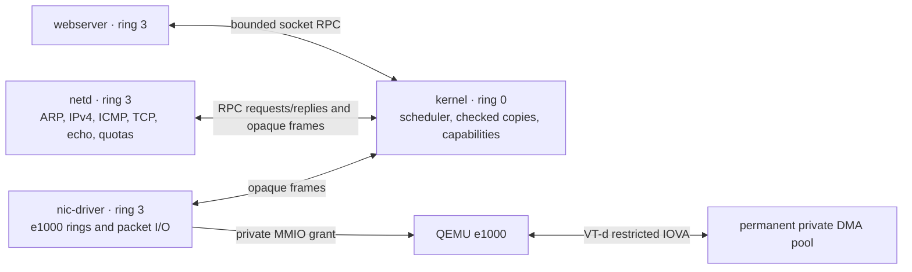

# Rust kernel

A small x86-64 kernel written in stable Rust that boots directly in QEMU.
The normal build runs **three separate ring-3 services**: an HTTP server,
an allocation-free [smoltcp](https://docs.rs/smoltcp/0.14.0/smoltcp/) network
service, and an Intel e1000 driver. The kernel provides address spaces,
preemption, checked IPC, and a narrow VT-d device-assignment boundary.
Ethernet packet handling, TCP/IP, and HTTP run outside ring 0.

This is a fixed QEMU experiment, targeting **q35, one CPU, an e1000 on PCI root
bus 0, and QEMU's Intel IOMMU**. It is not a general hardware driver framework,
a guarantee about physical-device isolation, or a claim about VM host security.

## Quick start

Install Rust with [rustup](https://rustup.rs/), QEMU, GNU binutils, Make, and
Python 3.10+. On Debian/Ubuntu:

```sh
sudo apt-get update
sudo apt-get install make binutils qemu-system-x86 python3
make setup
make run
```

The first build downloads the Rust bare-metal target and locked dependencies;
later builds use Cargo's cache. `make run` builds the kernel and all three service
ELFs, then boots QEMU with serial output in your terminal. Press **Ctrl-a**,
release both keys, then press **x** to exit. `make run-gui` also opens a VGA
window; a graphical desktop and QEMU display backend are required.

The production launch uses these required platform options:

```text
-machine q35 -device intel-iommu,intremap=off -cpu max,-apic -smp 1 -accel tcg
```

KVM access, TAP setup, root privileges, GRUB, and an ISO builder are unnecessary.
The kernel refuses device assignment if the required IOMMU or CPU/platform
conditions are missing. There is no fallback to unrestricted DMA. Keep `-apic`
in the CPU model: this QEMU-specific configuration has no local APIC device and
uses PIC/PIT scheduling interrupts instead. The reason is explained below.

Startup messages identify the services and endpoints; their order can vary:

```text
Isolation: three address spaces; bounded IPC; NIC DMA restricted by VT-d
Userspace network service: CPL=3
e1000 driver: CPL=3, VT-d DMA grant active
IPv4: 10.0.2.15/24, gateway 10.0.2.2
TCP echo listening on 10.0.2.15:1234
Userspace web server: CPL=3
HTTP listening on 10.0.2.15:80
```

## Web server

Open **http://127.0.0.1:8080/** after starting `make run`. QEMU forwards the
localhost port to guest TCP port 80. The first connection can take several
seconds while QEMU resolves the guest's network address.

```sh
curl http://127.0.0.1:8080/
curl http://127.0.0.1:8080/healthz
curl -I http://127.0.0.1:8080/
```

The HTTP parser and embedded page live in `build/webserver.elf`. `/healthz`
returns `ok` followed by a newline. Both routes support GET and HEAD; query
strings do not change route selection. Unknown paths return 404, unsupported
methods return 405, malformed requests return 400, and headers exceeding 2048
bytes return 431.

The server accepts HTTP/1.0 and HTTP/1.1, sends Content-Length, and closes each
connection after one response. HTTP/1.1 requires one nonempty Host header.
There are four connection slots with fixed buffers. Partial requests have an
absolute 5-second deadline; stalled sends or closes time out after 10 seconds.
The network service applies additional admission and lifetime limits below.
Request bodies, chunked transfer, persistent connections, and TLS are unsupported.

Use `make run HTTP_PORT=8081` to choose another host HTTP port. TCP echo is
available separately on localhost port 5555 during normal operation; service
restarts can reset existing connections.

## Services and IPC

Each service has its own CR3, physical backing, ELF image, stack, and saved
extended CPU state. Their common virtual entry address does not imply shared
memory.



| Executable | Responsibility | Access |
| --- | --- | --- |
| `build/webserver.elf` | HTTP parsing and responses | Four socket handles, port 80 only |
| `build/netd.elf` | smoltcp, TCP echo, HTTP sockets, admission control | Frame queues and socket RPC endpoint |
| `build/nic-driver.elf` | e1000 register programming and RX/TX descriptors | Its assigned MMIO window, private DMA pool, and frame queues |

The kernel never interprets Ethernet, IP, TCP, or HTTP packets in the normal
build. It copies opaque frames through **two fixed queues**, one per direction,
each holding **16 frames of at most 1514 bytes**. Full queues return `EAGAIN`.
No service receives another service's pointers or direct access to its buffers.

Socket RPC uses fixed `Request` and `Reply` records containing integers and at
most 4096 payload bytes. One web request can be outstanding. The kernel checks
full user buffer ranges and read/write permissions before copying data or
changing queue state. It issues monotonically increasing request-generation
IDs, validates reply IDs and lengths, and rejects stale replies. An unanswered
RPC has a **2-second deadline**, after which the affected services restart.

The shared `abi.rs` uses RAX for the syscall number/result and RDI, RSI, RDX for
arguments. A DPL-3 `int 0x80` gate enters a TSS kernel stack. Errors are negative
error numbers. Capabilities are assigned from the calling process's identity;
passing another handle or syscall number cannot select another service's role.

| Number | Call | Allowed caller / behavior |
| --- | --- | --- |
| 0 | Poll | All services; yield to the scheduler and update heartbeat |
| 1 | Clock | All services; HPET milliseconds |
| 2 | Socket state | Web; state, readiness flags, and queued TX bytes via RPC |
| 3 / 4 | Receive / send | Web; handle, user buffer, length; at most 4096 bytes |
| 5 / 6 | Close / abort | Web; socket handle |
| 7 | Listen | Web; handle and port 80 only |
| 8 | Log | All services; UTF-8, at most 512 bytes per call and 4096 bytes/s per service |
| 9 | Exit | All services; stop the caller and trigger supervised recovery |
| 10 / 11 | Frame receive / send | Network service; copy from RX / into TX queue |
| 12 / 13 | Network request / reply | Network service; receive socket RPC / submit its reply |
| 14 / 15 | Driver RX / TX | NIC driver; copy into RX queue / from TX queue |
| 16 | Driver ready | NIC driver; request kernel-controlled bus-master enable |
| 17 | MAC | Network service; read the driver-registered packed MAC |
| 18 | Register MAC | NIC driver; publish a validated unicast MAC |

## CPU, memory, and scheduling

Each ELF occupies a private 2 MiB virtual window beginning at `0x40000000`,
with a 64 KiB stack. Code is RX, constants are R/NX, and data and stacks are
RW/NX. A guard page below each user stack is unmapped. Kernel memory, page
tables, trap stacks, and the other processes' physical backing remain
supervisor-only. Only the driver receives the extra MMIO and DMA mappings.

Kernel text is RX, constants are R/NX, and writable kernel storage is RW/NX.
The null page and guards below boot, trap, and double-fault stacks are unmapped.
NX and CR0.WP enforce page permissions; SMEP and SMAP are enabled when available.
The broad supervisor identity mapping remains an explicit limitation.

Process switches save and restore **FXSAVE64 state**: x87/MMX, MXCSR, and
XMM0–XMM15. Restarts clear that state as well as program memory. FXSR, SSE, and
SSE2 support are required. OSXSAVE remains disabled: AVX/XSAVE instructions are
not supported, even if the emulated CPU advertises wider vector capabilities.

The system has exactly three embedded services on **one CPU**, without user
threads or a general process-launching API. A 100 Hz PIT can preempt a process
that never yields. Userspace runs with IF set and IOPL zero. The kernel handles
traps and IPC with IF clear and bounds a service's syscall run to **64 calls or
10 milliseconds**, checked between calls. Kernel operations are not themselves
preempted. Driver and network services must yield at least every **2 seconds**;
a missed heartbeat triggers recovery.

| Failure | Recovery |
| --- | --- |
| Web or network process fault/exit; network RPC timeout | Restart network and web, clear pending RPC and frame queues |
| Driver fault/exit, heartbeat expiry, or detected DMA violation | Disable bus mastering, reset/quiesce NIC, revoke DMA mappings, then restart all services |
| Device teardown or reassignment cannot be completed safely | Quarantine networking; do not resume device access |

Restart delays back off from **100 ms to 6400 ms** for repeated failures.
Connection state is discarded during dependent-service restarts, so clients
must reconnect. Timer preemption, deadlines, queues, and restart supervision
bound resource use; they do not guarantee service availability against a
malicious process or network peer.

## NIC and DMA boundary

The supported NIC is QEMU's **e1000 / Intel 82540EM** (`8086:100e`) directly on
**PCI root bus 0**. `e1000e`, devices behind bridges, arbitrary requester aliases,
and general PCI passthrough are outside this implementation.

The driver maps a 128 KiB MMIO window at `0x50000000` and a permanently allocated
**260 KiB (`0x41000`) DMA pool** at `0x50200000`. VT-d maps only that pool into the
NIC's domain, starting at **IOVA `0x10000000`**. Other requesters and other IOVAs
are denied; there is no DMA identity or pass-through domain. The pool contains
no kernel objects, stays pinned through resets, and is never reused as another
process's memory. The driver uses 64 RX and 64 TX descriptors with fixed buffers.

The kernel owns PCI assignment, VT-d tables, DMA grants/revocation, bus-master
enable/disable, and reset sequencing. Ring-3 code owns normal e1000 operation.
Device teardown stops bus mastering and resets/drains the device before
revoking translations; failure leaves networking quarantined. Limited ACPI DMAR
discovery supports this specific q35 setup, not arbitrary firmware platforms.

DMA translation alone does **not** isolate QEMU's interrupt-message aperture.
A malicious descriptor can target that aperture to synthesize interrupt messages.
This build therefore requires **no local APIC device**, using
`-cpu max,-apic -smp 1`; merely clearing the APIC-enable bit is insufficient.
PCI INTx is disabled, and the guest uses PIC/PIT for scheduling. This is a narrow
QEMU-specific constraint, not a replacement for a general interrupt-remapping
implementation. Missing VT-d, an APIC-present CPU, or unsupported device topology
causes `Network isolation unavailable:` and refusal to start the services.

## Networking

`make run` uses QEMU's user-mode backend. The guest has static IPv4 address
**10.0.2.15/24**, gateway **10.0.2.2**, and a **1500-byte IP MTU**. TCP port
**1234** echoes bytes; QEMU forwards it to **127.0.0.1:5555**.

```sh
python3 - <<'PYTHON'
import socket

with socket.create_connection(("127.0.0.1", 5555), timeout=10) as client:
    client.sendall(b"hello from the host\n")
    client.shutdown(socket.SHUT_WR)
    print(client.makefile("rb").read().decode(), end="")
PYTHON
```

Echo handles one client at a time, preserves bytes under backpressure, drains
data after a peer half-close, and reopens after close/reset. Its RX and TX socket
buffers are 16 KiB each. smoltcp supplies retransmission, checksums, sequencing,
and flow control inside the network process.

Use `make run HOST_PORT=5556` to change the host echo port. `QEMU_NET` replaces
the NIC/backend arguments; `make run QEMU_NET="-nic none"` reports the missing
NIC and refuses network startup. Keep the supported platform and NIC constraints
when overriding launch options.

ARP and IPv4 ICMP echo replies are supported. QEMU user-mode networking does
not expose the guest to host `ping 10.0.2.15`; `make test-packets` instead injects
Ethernet frames through a private QEMU socket backend. IPv6, UDP sockets, DHCP,
DNS, VLANs, jumbo frames, and IPv4 fragment reassembly are disabled.

The **network service** applies these limits to new HTTP connections:

| Limit | Value |
| --- | --- |
| Active HTTP connections per source IPv4 address / total | 3 / 4 |
| New SYN allowance per source | Burst 32; refill 16/s |
| New SYN allowance across sources | Burst 64; refill 32/s |
| Source table | 32 entries; expire after 30 idle seconds; no eviction of recent sources |
| Half-open handshake / absolute connection lifetime | 3 seconds / 15 seconds |

Validated SYN retransmissions for an existing tuple spend no additional tokens.
Existing connection traffic and echo do not spend HTTP admission tokens. Invalid
IPv4/TCP checksums are rejected before SYN admission. Existing tuples take
priority over free listeners so retransmission cannot create duplicate sockets.
Clients behind one source address share its quota. These limits do not prevent
distributed abuse, source spoofing, or link saturation. TCP sequence seeds use
boot timing rather than cryptographic entropy.

## Commands and tests

| Command | Result |
| --- | --- |
| `make` / `make build` | Build `build/kernel.bin` and all three service ELFs |
| `make run` / `make run-gui` | Build and boot with terminal / VGA output |
| `make test` | Run boot, legacy privilege, service isolation, preemption, admission, TCP, ARP/ICMP, and HTTP targets |
| `make test-services` | Exercise the production service/DMA/IPC boundary and recovery |
| `make test-userspace` | Run the separate legacy kernel WP/NX and ring-3 privilege baseline |
| `make test-preemption` | Check TCP progress during busy and syscall-only web loops |
| `make test-host` | Host admission and retransmitted-SYN dispatch regressions |
| `make test-abuse` | HTTP source quotas, half-open expiry, and recovery |
| `make test-net` | Binary echo, socket/ring wrap, half-close, reconnect, and reset |
| `make test-packets` | Raw Ethernet ARP, ICMP, and checksum rejection |
| `make test-http` | HTTP routes, framing, errors, concurrency, and timeouts |
| `make test-boot` | CPU/memory bootstrap checks without networking |
| `make fuzz` | Local HTTP, TCP, and syscall mutation campaigns |
| `make fuzz-http` / `make fuzz-tcp` | HTTP / raw TCP/IP mutations in a private QEMU network |
| `make fuzz-syscalls` | Seeded ring-3 calls against the production IPC broker |
| `make check` | Formatting and Clippy checks |
| `make debug` | Boot paused; GDB on `127.0.0.1:1234` |
| `make clean` | Remove generated files |

`make test-services` builds the `isolation-test` feature. Its checks cover separate
address spaces and saved SIMD/FPU state, actual forbidden DMA reads and writes,
QEMU interrupt-aperture NMI/INIT/SMI probes, invalid IPC buffers and capabilities,
malformed replies against a real pending RPC, and service crashes/restarts.
The harness probes binary echo during recovery, requires three successful
exchanges after the completion marker, and separately boots without an IOMMU
and with an APIC-present CPU to require refusal before any ring-3 service starts.
These are bounded implementation tests for the stated QEMU target, not a proof
of hardware isolation or VM host security.

The `userspace-test` feature is a deliberately separate baseline using the old
ring-0 e1000/stack path. It checks kernel WP/NX, real CPL, invalid syscalls and
buffers, forbidden memory and I/O access, stack/code permissions, privileged
instructions, direction flags, and invalid return stacks on `qemu64` and `max`.
Only this feature compiles `src/legacy_net.rs`, `src/e1000.rs`, and the old socket
syscall implementation. It is not the production service/DMA test. The
`fuzz-test` feature uses the new production broker.

TCP/packet and service-isolation harnesses have 30-second deadlines, HTTP has
45 seconds, and the preemption test has 25 seconds. Tests choose temporary
localhost ports and stop their QEMU process on success or failure. Echo includes
a 320 KiB fragmented binary transfer; packet checks include varied ICMP replies
and bad checksums. The boot test has a 15-second limit and requires its success
marker plus QEMU debug-exit status 33. Test images use separate build directories.

Install optional Rust tools when needed:

```sh
rustup component add rustfmt clippy
make check
```

Tools can be overridden, for example `make run QEMU=/path/to/qemu-system-x86_64`.
Append diagnostic options with
`make run QEMU_FLAGS="-d guest_errors -D build/qemu.log"`.

For debugging:

```sh
make debug
# In another terminal:
gdb target/x86_64-unknown-none/release/kernel
(gdb) target remote 127.0.0.1:1234
(gdb) hbreak kernel_main
(gdb) continue
```

Service symbols are in `build/webserver.elf`, `build/netd.elf`, and
`build/nic-driver.elf`, also copied alongside the kernel ELF. Load the symbols
for the service being inspected, for example `add-symbol-file build/netd.elf`.
All services link at `0x40000000`; distinguish their address spaces using CR3
rather than assuming that a virtual address identifies one process. Use a GDB
build with x86-64 support (`gdb-multiarch` on non-x86 hosts).

## Local fuzz campaigns

The fuzz scripts start their own QEMU instance. Network mutations go only to
that child's private Ethernet socket backend; there is no remote-target option.
HTTP cases mutate requests and split them across TCP segments. TCP cases mutate
flags, options, sequence numbers, payloads, checksums, truncation, and fragment
fields, including cases with established connections. Periodic HTTP and binary
echo checks look for service failures after malformed input. The syscall
campaign runs in the web process against the production IPC broker, varying call
numbers, capabilities, handles, pointers, lengths, and socket operations while
checking results and buffer canaries. The `fuzz-test` build uses the three-service
scheduler; it does not enable the legacy ring-0 network stack.

These are seeded, mutation-based robustness tests, not coverage-guided fuzzing.
A successful campaign reports only the cases exercised; it is not a security
proof. `make test` does not run the longer fuzz campaigns.

| Make variable | Default | Applies to |
| --- | --- | --- |
| `FUZZ_SECONDS` | `30` | Target duration of each HTTP/TCP campaign |
| `FUZZ_SEED` | `1` | Input generation for all campaigns |
| `FUZZ_ITERATIONS` | `100000` | Number of syscall test cases |
| `FUZZ_TIMEOUT` | `120` | Syscall QEMU run timeout in seconds |

For example:

```sh
make fuzz
make fuzz FUZZ_SECONDS=60 FUZZ_SEED=42 FUZZ_ITERATIONS=1000000 FUZZ_TIMEOUT=120
```

Each campaign saves artifacts below `build/fuzz/`. Network runs include
`serial.log`, `stderr.log`, an input-frame trace in `frames.jsonl`, and
`summary.json` with the seed, case count, result, and `replay_cases`. HTTP runs
also preserve the latest request; failures save the last frame and failure
message. Syscall runs save serial/stderr logs and a summary; the serial log
records the compiled seed, iteration count, and any failing case.

Replay network input generation with the mode, seed, and `replay_cases` from
the saved summary. For example, to run exactly 100 HTTP cases:

```sh
python3 scripts/fuzz_network.py qemu-system-x86_64 build/kernel.bin \
  --mode http --seed 42 --cases 100
```

Use `--mode tcp` for TCP cases. Timing and guest responses can differ between
runs; the frame trace preserves what was actually sent. Replay a syscall
campaign by rebuilding with the same seed and iteration count:

```sh
make fuzz-syscalls FUZZ_SEED=42 FUZZ_ITERATIONS=1000000 FUZZ_TIMEOUT=120
```

## Boot and source layout

QEMU loads the flat `build/kernel.bin` through its Multiboot v1 address header.
The kernel links at physical 1 MiB. Assembly clears BSS, establishes a 256 KiB
boot stack and initial 4 GiB identity map, then enters 64-bit mode. The first
1 GiB is cached; the initial 1–4 GiB MMIO area is uncached. Kernel initialization
installs descriptor tables, page permissions, stack guards, and the PIC/PIT.
The service loader builds separate page-table roots with shared supervisor
mappings and private user pages. The kernel loads three embedded ELF images;
`objcopy` creates the boot image, not a disk image or ISO.

| File | Purpose |
| --- | --- |
| `src/boot.S`, `src/main.rs` | Multiboot entry, long-mode bootstrap, checks, panic handler |
| `src/console.rs` | VGA text and serial output |
| `src/net.rs` | Production service scheduler, capabilities, opaque frame queues, RPC broker, recovery |
| `src/device.rs`, `src/pci.rs` | Narrow PCI assignment, private DMA lifetime, controlled reset/bus mastering |
| `src/iommu.rs` | QEMU VT-d discovery, translation tables, faults, grant/revoke |
| `src/userspace.rs` | ELF loading, separate CR3 roots, checked copies, FXSAVE64 process state |
| `src/memory.rs` | Kernel page permissions, stack guards, page-table audits |
| `src/arch.rs`, `src/traps.S` | GDT/TSS/IDT, traps, IRQs, ring transitions |
| `src/time.rs`, `src/timer.rs` | HPET clock and 100 Hz PIC/PIT preemption |
| `abi.rs` | Shared capability-based syscall and pointer-free RPC records |
| `userspace/main.rs`, `userspace/http.rs`, `userspace/syscall.rs` | Web process, HTTP parser/page, socket wrappers |
| `userspace/netd.rs`, `userspace/net_syscall.rs` | smoltcp service, echo, HTTP sockets, frame/RPC calls |
| `src/abuse.rs` | Allocation-free HTTP admission/expiry code reused by netd and host tests |
| `userspace/driver.rs`, `userspace/e1000.rs` | Ring-3 driver entry, MMIO, descriptors, packet I/O |
| `userspace/linker.ld`, `userspace/services/Cargo.toml` | Separate service ELF layout and smoltcp build |
| `src/legacy_net.rs`, `src/e1000.rs`, `src/syscall.rs`, `src/user_test.rs` | Ring-0 networking and privilege baseline, compiled only for `userspace-test` |
| `scripts/isolation_test.py` | Production service/DMA/IPC containment, recovery, and fail-closed boot |
| `scripts/userspace_test.py`, `scripts/preemption_test.py` | Legacy privilege baseline / production scheduling progress |
| `tests/host`, `scripts/abuse_test.py` | Admission and TCP dispatch/recovery regressions |
| `scripts/network_test.py`, `scripts/packet_test.py`, `scripts/http_test.py` | TCP, raw Ethernet, and HTTP integration harnesses |
| `scripts/fuzz_network.py`, `userspace/fuzz.rs`, `scripts/fuzz_syscalls.py` | Mutation campaigns and reproducibility logs |
| `linker.ld`, `.cargo/config.toml`, `build.rs`, `Makefile` | Kernel layout, target flags, service embedding, build/run/test commands |
| `scripts/smoke_test.py` | Bounded bootstrap checks |

The project has no heap allocator, filesystem, keyboard input, general process
launcher, SMP support, or UEFI boot path. Networking is polled, so an idle guest
uses CPU time. CPU protection, the fixed DMA boundary, bounded IPC, quotas, and
fuzz campaigns do not make it a production-hardened operating system. Static
addressing, weak boot-time entropy, four HTTP slots, and lack of TLS remain
intentional limitations.

References: [Rust bare-metal target](https://doc.rust-lang.org/rustc/platform-support/x86_64-unknown-none.html),
[Multiboot specification](https://www.gnu.org/software/grub/manual/multiboot/multiboot.html),
[QEMU options](https://www.qemu.org/docs/master/system/invocation.html),
[QEMU networking](https://www.qemu.org/docs/master/system/devices/net.html),
[Intel system programming manuals](https://www.intel.com/content/www/us/en/developer/articles/technical/intel-sdm.html),
[Intel 8254x manual](https://www.intel.com/content/dam/doc/manual/pci-pci-x-family-gbe-controllers-software-dev-manual.pdf).
